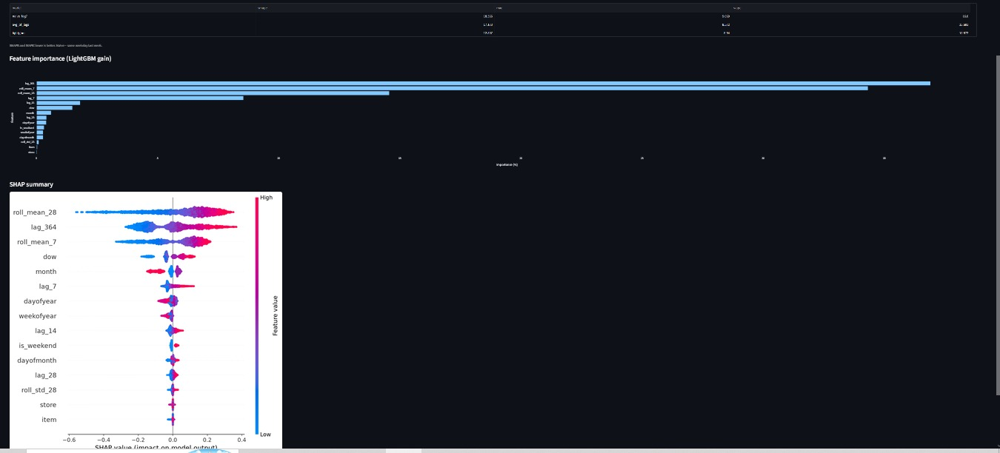
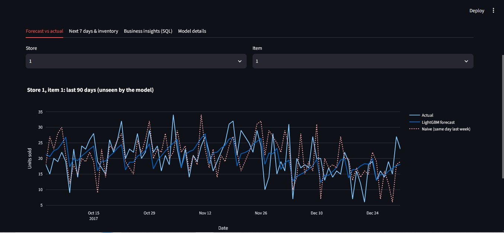
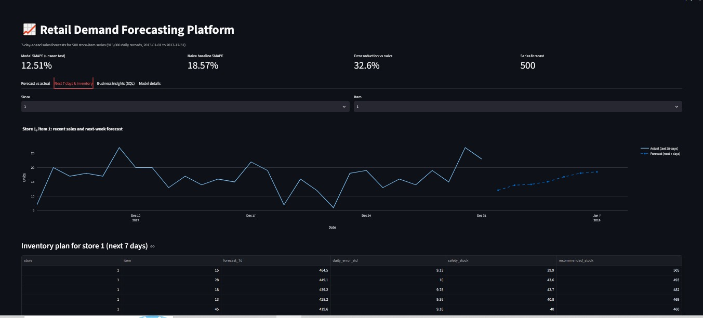
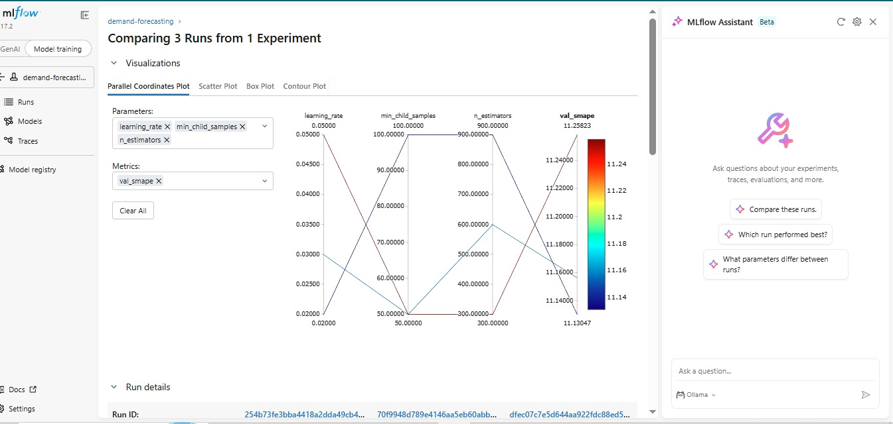
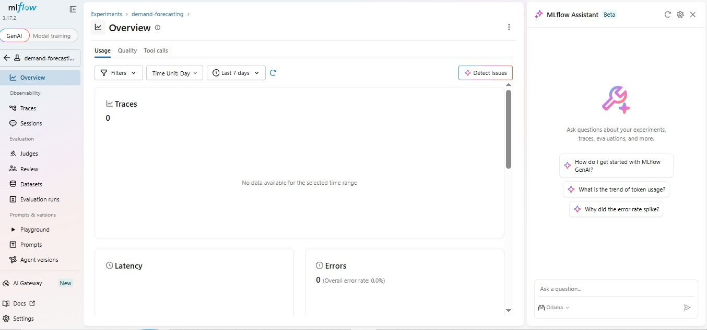
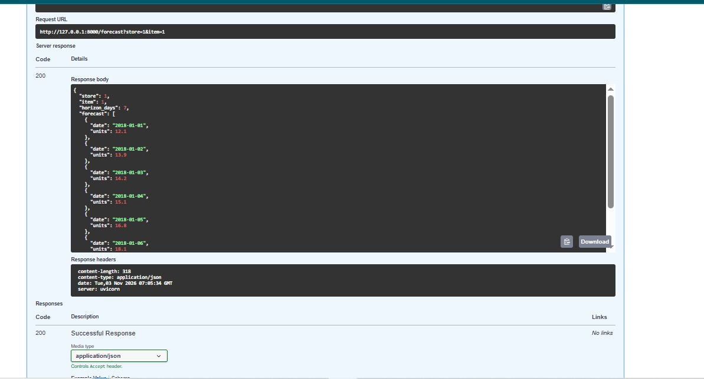

# Retail Demand Forecasting Platform

End-to-end demand forecasting for 10 stores × 50 items (913K daily records): SQL analysis, time-series ML with experiment tracking, a REST API, and an interactive dashboard with an inventory planning view.

**Live demo:** coming soon



## Results (last 90 days, unseen data)

| Model | SMAPE | MAE | WAPE |
|---|---|---|---|
| Naive (same weekday last week) | 18.57% | 9.07 | 16.60% |
| Average of last 3 weekly lags | 17.17% | 8.57 | 15.69% |
| **LightGBM** | **12.51%** | **5.94** | **10.87%** |

LightGBM reduces SMAPE by **32.6%** vs the naive baseline.

## What it does

- **SQL analysis:** yearly growth (LAG), store ranking (RANK), item share, weekday patterns and monthly seasonality using CTEs and window functions
- **Forecasting:** 7-day horizon; lag, rolling and calendar features that only use data at least 7 days old; log-transformed target
- **Validation:** time-based train / validation / test split (no leakage); 3 LightGBM configurations compared on validation, the best one scored once on the test window
- **Experiment tracking:** all runs logged with MLflow
- **Inventory planning:** recommended stock = 7-day forecast + safety stock (about 95% service level, from forecast error)
- **Serving:** FastAPI endpoint `/forecast?store=1&item=1`
- **Dashboard:** Streamlit app with forecast vs actual, inventory plan, SQL insights and model details

## Key findings

- Strong seasonality: July demand is about 28% above average, January about 32% below
- Sunday is the busiest weekday and Monday the slowest
- Year-over-year growth slowed from 15% (2014) to under 4% (2017)
- Most important features: 28-day rolling mean, same weekday last year, 7-day rolling mean

## Screenshots








## Project structure

```
src/    features, SQL loading + analysis, training, SHAP
app/    FastAPI service and Streamlit dashboard
outputs/ forecasts, metrics, inventory plan, SQL results
```

## Run it yourself

```bash
pip install -r requirements-train.txt
# download train.csv from https://www.kaggle.com/c/demand-forecasting-kernels-only/data into a data/ folder
python src/load_to_db.py
python src/sql_insights.py
python src/train.py
python src/explain.py            # optional SHAP plot
uvicorn app.api:app --reload     # API docs at http://127.0.0.1:8000/docs
streamlit run app/dashboard.py   # dashboard at http://localhost:8501
```

## Tech stack

Python, pandas, SQL (SQLite), LightGBM, MLflow, FastAPI, Streamlit, Plotly

## Dataset

Kaggle Store Item Demand Forecasting Challenge (daily sales, 2013-2017).